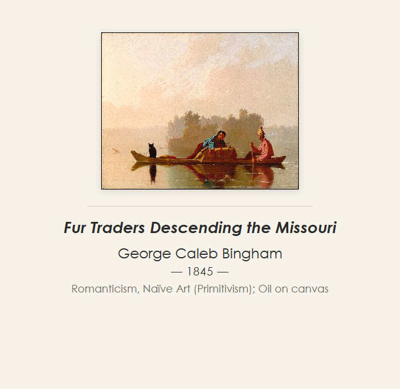
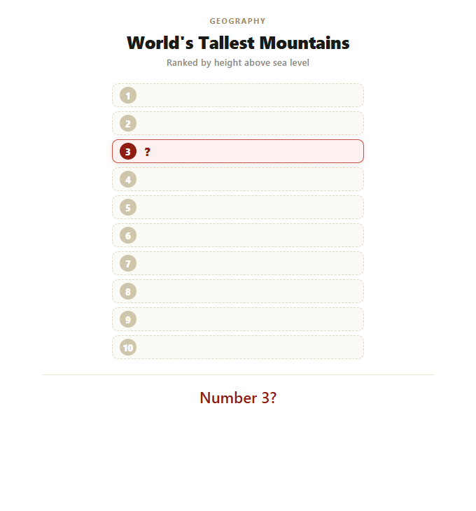

# QBCards & StockFisher

## StockFisher

StockFisher downloads the [QBReader](https://www.qbreader.org/) question database into a local SQLite index (671,413 tossups and bonus parts across 716 sets as of November 2026) and extracts the recurring stock clues for any answerline. Clues are grouped by where they fall in the tossup (Power, Middle, Giveaways, Bonuses) and ordered by importance across three factors: how often the clue appears (weighted by how exclusive it is to that answer), how early in the question it shows up, and the difficulty levels at which it gets asked.


Clicking any clue card opens the full tournament question beside your results with the matching sentence highlighted. If Anki is open with AnkiConnect, StockFisher also checks your collection and marks which clues are already covered by active cards, which sit on suspended cards, and which are missing. You can also test a draft clue for answer giveaways or export a shortlist to CSV.

### Setup

Requires Python 3.9+ and uses only the standard library (no `pip install` step). The first sync downloads the corpus from QBReader and builds the local FTS5 index (~900 MB):

```bash
git clone https://github.com/tygerthelyon/qbcards.git
cd qbcards
python -m qbr sync
python -m qbr.app
```

On Windows, double-clicking `Open StockFisher.cmd` opens the app in a standalone Chrome or Edge window. Run `python -m qbr sync` whenever you want to pull newer tournament sets. If you already keep `qbreader.sqlite` in another folder, click Index in the top right to point the app at it, or set `QBR_DB` in your environment.

See [`docs/stockfisher.md`](docs/stockfisher.md) for a walkthrough of the app, or [`qbr/README.md`](qbr/README.md) if you prefer running queries from the terminal or Python scripts.

## Anki decks

The collection has 11,921 notes and 34,848 cards built over five years of study, covering visual art, architecture, classical music, geography, biology, physics, philosophy, and history.

| Art: front | Art: back |
| --- | --- |
|  |  |
| Classical music: front | Classical music: back |
|  |  |
| Ranked list: front | Ranked list: back |
|  |  |
| Geography: front | Geography: back |
|  |  |

More examples across all 11 note types are in the [card gallery](docs/card-gallery.md).

Packaged `.apkg` files are available on the [releases page](https://github.com/tygerthelyon/qbcards/releases/tag/decks-2026-11-12); see [`docs/decks.md`](docs/decks.md) for the subject breakdown. The repository also includes [sample JSON notes](samples/), [card templates and stylesheets](templates/models.json), and the [maintenance scripts](scripts/) used to keep formatting consistent across decks.

## Buzz Drill

A single-page tossup reader containing 1,864 tossups matched to answers in the study collection. Pick your categories, question count, and reading speed (words per second), buzz with `Space`, and score yourself. It prioritizes questions you haven't heard recently and charts your buzz depth and accuracy across sessions in `localStorage`.


To run it locally:

```bash
python -m http.server 8000
```

Then open <http://localhost:8000/drill/buzz-drill.html>.

## Tests & attribution

Offline unit tests run with `python -m unittest discover -s tests -v`. A fuller regression suite (`python -m qbr.selftest`) also checks a synced database against the live QBReader API.

Questions indexed by StockFisher and used in Buzz Drill come from [QBReader](https://www.qbreader.org/) and are available on its public database; see [QBReader's notes on question sources](https://github.com/qbreader#questions). Code in this repository is under the [MIT License](LICENSE); artwork, maps, audio clips, and question text in the decks and examples remain under their respective rights.
