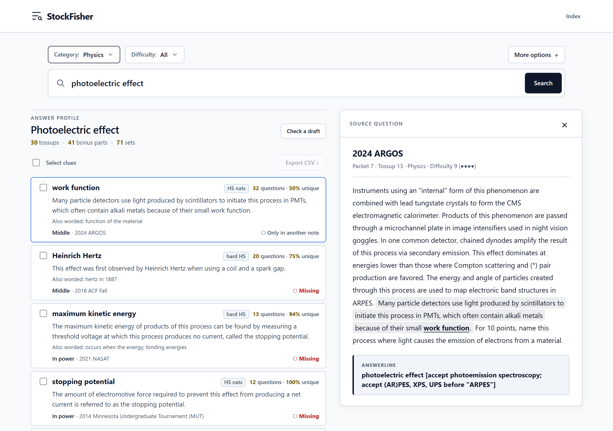
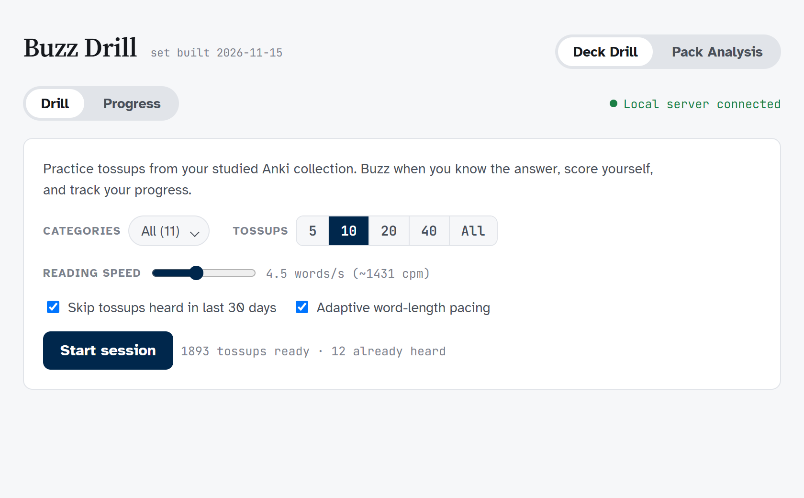
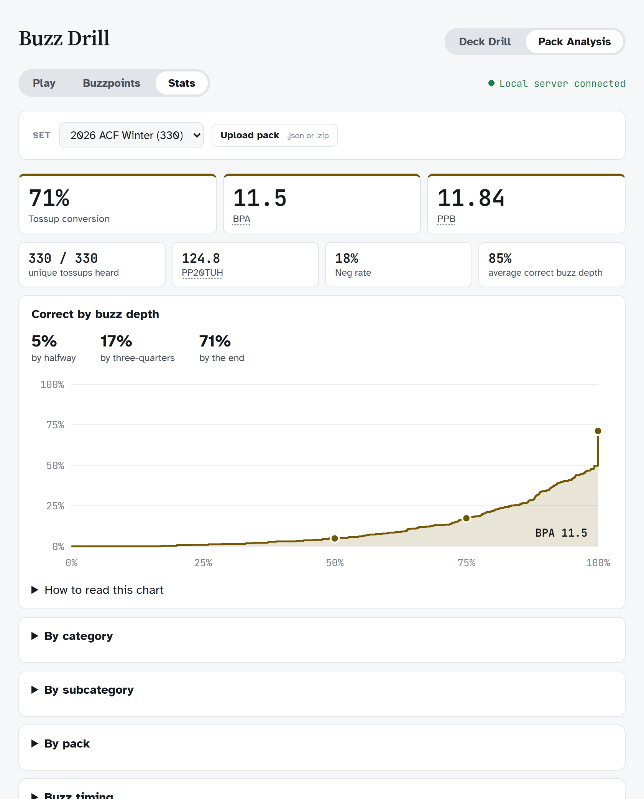

# QBCards & StockFisher

Two quizbowl study apps, [StockFisher](#stockfisher) and [Buzz Drill](#buzz-drill), plus my [Anki decks](#anki-decks).

## Download

**Windows** (Python is built in, so there is nothing to install):

1. Download **[QBCards-Windows.zip](https://github.com/tygerthelyon/qbcards/releases/download/windows-app/QBCards-Windows.zip)** (13 MB).
2. Right-click it and choose **Extract All**.
3. In the extracted QBCards folder, double-click **Start Buzz Drill** or **Start StockFisher**.

If Windows asks whether to run the file, click **Run** (or **More info**, then **Run anyway**). Keep the black window open while you use an app; close it to quit. StockFisher's first start downloads the QBReader questions (about 900 MB, around 10 to 20 minutes).

**Mac or Linux:** open Terminal, paste this line, and press Return. It downloads the apps into your home folder and starts Buzz Drill:

```bash
curl -fsSL https://github.com/tygerthelyon/qbcards/archive/refs/heads/main.zip -o qbcards.zip && unzip -oq qbcards.zip && python3 qbcards-main/drill_server.py --open
```

If your Mac asks to install the command line developer tools, click **Install**, wait for it to finish, and paste the line again. Pasting it again later also updates the apps and keeps your results. For StockFisher, paste `cd qbcards-main && python3 -m qbr sync && python3 -m qbr.app` instead.

## StockFisher

StockFisher downloads the [QBReader](https://www.qbreader.org/) question database into a local SQLite index (671,413 tossups and bonus parts across 716 sets as of November 2026) and extracts the recurring stock clues for any answerline. Each clue shows how many questions on the answer use it, how unique it is to that answer (the share of every question holding those words that is about this answer), where it falls in a tossup (in power, middle, giveaway, or bonus only), and its usual difficulty. Clues are ranked by importance, questions × uniqueness, so a classic clue asked twenty times outranks a one-off and a clue unique to the answer outranks a common word. Other wordings of the same clue are folded into one card.



Clicking any clue card opens the full tournament question beside your results with the matching sentence highlighted. If Anki is open with AnkiConnect, StockFisher also checks your collection and marks each clue as studied, a card not yet studied, suspended, written on the answer's own note, only mentioned in another note, or missing. You can also test a draft clue for answer giveaways or export a shortlist to CSV.

### Running from source

To run it, see [Download](#download). From a clone, StockFisher needs Python 3.9+ and only the standard library (no `pip install` step). The first sync downloads the corpus from QBReader and builds the local FTS5 index (~900 MB):

```bash
git clone https://github.com/tygerthelyon/qbcards.git
cd qbcards
python -m qbr sync
python -m qbr.app
```

On Windows, double-clicking `Open StockFisher.cmd` opens the app in a standalone Chrome or Edge window. Run `python -m qbr sync` whenever you want to pull newer tournament sets. If you already keep `qbreader.sqlite` in another folder, click Index in the top right to point the app at it, or set `QBR_DB` in your environment.

See [`docs/stockfisher.md`](docs/stockfisher.md) for a walkthrough of the app, or [`qbr/README.md`](qbr/README.md) if you prefer running queries from the terminal or Python scripts.

## Anki decks

The collection has 12,084 notes and 35,191 cards built over five years of study, covering visual art, architecture, classical music, geography, biology, physics, philosophy, and history.

| Art: front | Art: back |
| --- | --- |
|  |  |
| Classical music: front | Classical music: back |
|  |  |
| Ranked list: front | Ranked list: back |
|  |  |
| Geography: front | Geography: back |
|  |  |

More examples across all 11 note types are in the [card gallery](docs/card-gallery.md).

Packaged `.apkg` files are available on the [releases page](https://github.com/tygerthelyon/qbcards/releases/tag/decks-2026-11-16). They keep my study order, suspensions, and deck options when imported with learning progress and deck presets ticked; see [`docs/decks.md`](docs/decks.md) for the subject breakdown and import steps. The repository also includes [sample JSON notes](samples/), [card templates and stylesheets](templates/models.json), and the [maintenance scripts](scripts/) used to keep formatting consistent across decks.

## Buzz Drill

A tossup reader for practising on real questions. It has two modes:

- **Deck Drill** reads 1,905 tossups on 695 answers from the study collection. Pick categories, question count, and reading speed, buzz with `Space`, press `G` to mark a guess, and score yourself. Questions you heard in the last 30 days are skipped.
- **Pack Analysis** plays a whole tournament set in pack order, tossups or bonuses. Type the name of any of the 700+ sets on QBReader and click **Download and play**, or upload a set as QBReader-format question JSON (or a `.zip` of pack files). Then review every buzz on **Buzzpoints** and your performance on **Stats**.



Stats use standard quizbowl measures: conversion (correct ÷ tossups heard), BPA (buzz point AUC, 0–100: conversion at every point of the question, summed), points per 20 tossups heard (PP20TUH), and points per bonus (PPB), with breakdowns by category, pack, and buzz timing.



To run it, see [Download](#download). From a clone, start the local server and open the page it prints (<http://127.0.0.1:8788/>):

```bash
python drill_server.py --open
```

On Windows with Python installed, double-clicking `launch_drill.pyw` does the same in an app window. The server saves every buzz, bonus, and session to `data/drill/` (one file per set, never committed), so results survive closing the browser. If Anki is open with AnkiConnect, the server also marks which answers are already in your collection. Served by any plain web server instead (`python -m http.server`, then open `/drill/buzz-drill.html`), the page runs Deck Drill in standalone mode and keeps results in the browser.

## Tests & attribution

Offline unit tests run with `python -m unittest discover -s tests -v`. A fuller regression suite (`python -m qbr.selftest`) also checks a synced database against the live QBReader API.

Questions indexed by StockFisher and used in Buzz Drill come from [QBReader](https://www.qbreader.org/) and are available on its public database; see [QBReader's notes on question sources](https://github.com/qbreader#questions). Code in this repository is under the [MIT License](LICENSE); artwork, maps, audio clips, and question text in the decks and examples remain under their respective rights.
