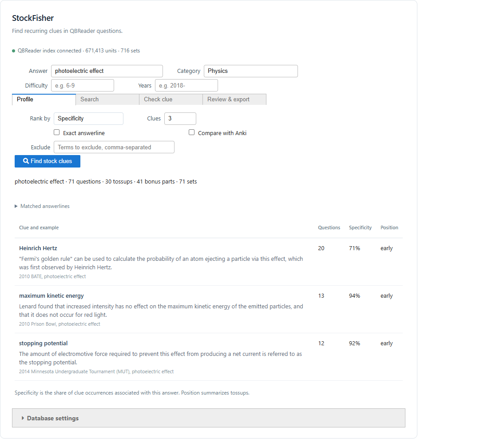
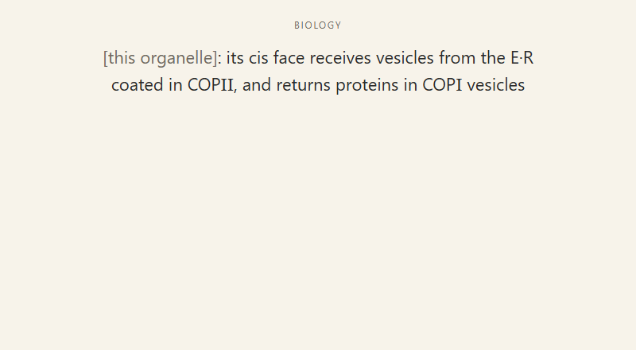
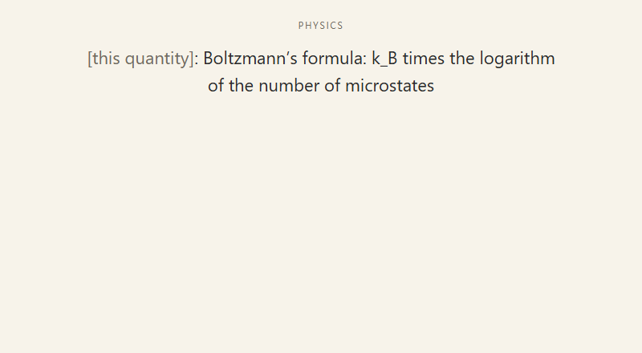
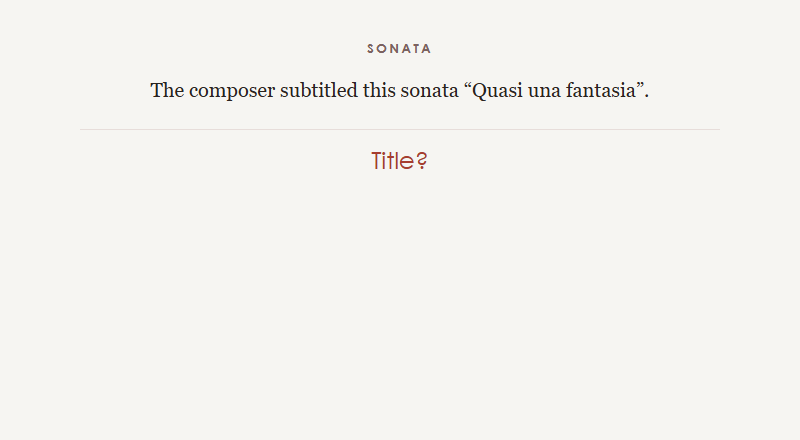
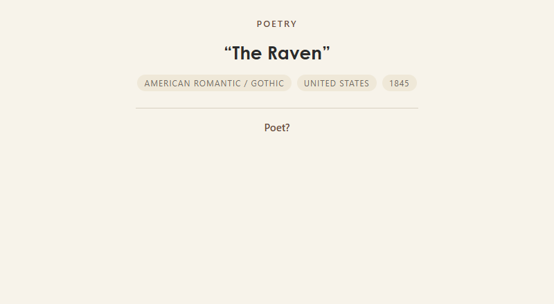
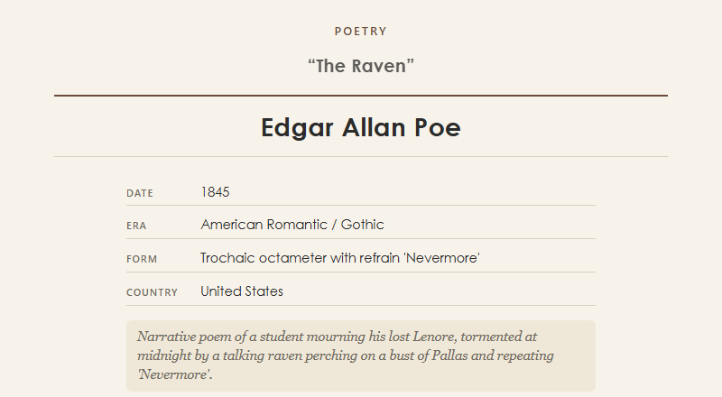
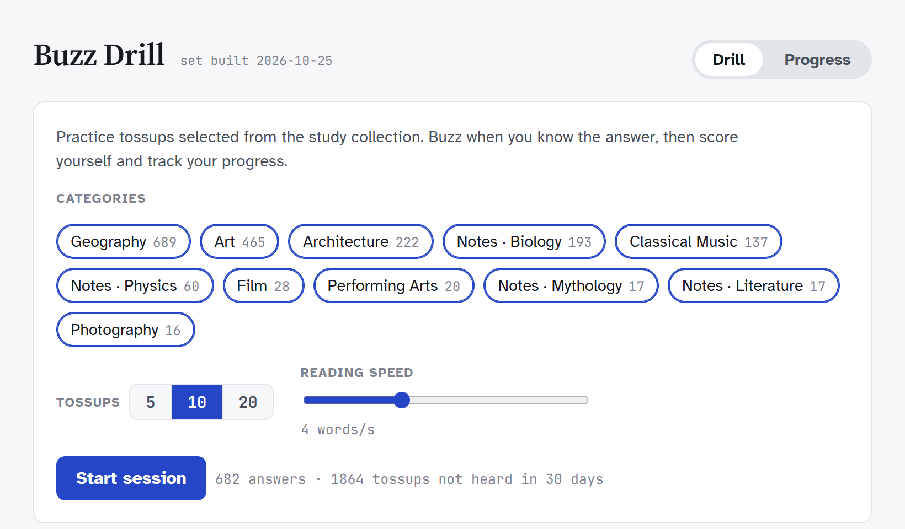

# Quizbowl study tools

Tools for researching clues, studying cards, and practicing tossups.

- [StockFisher](StockFisher.ipynb) finds recurring clues in QBReader questions.
- [Anki cards](#anki-cards) cover physics, biology, fine arts, history, and other subjects.
- [Buzz Drill](#buzz-drill) displays tossups word by word and records practice sessions.

## StockFisher

Choose an answer and category in the [notebook](StockFisher.ipynb), then run the cell:

```python
from qbr.notebook import StockFisherNotebook

answer = "photoelectric effect"
category = "Physics"
difficulty = ""              # e.g. "6-9"
years = ""                   # e.g. "2018-"
rank_by = "spec"             # specificity; use "n" for frequency or "pyramid" for position
clues = 15

research = StockFisherNotebook(
    answer=answer, category=category, difficulty=difficulty,
    year=years, ranking=rank_by, limit=clues,
)
research.run_profile()
research.display()
```

The results show recurring clues, question counts, where clues tend to appear, and examples from the source questions. The notebook also searches question text, checks draft clues, and exports selected results to CSV. You can optionally compare results with your Anki notes using AnkiConnect.



### How it works

StockFisher uses questions from [QBReader](https://www.qbreader.org/). The sync command downloads them through QBReader's API and builds a local SQLite index. Searches and clue rankings run against that index, which lets the program compare many questions without fetching them again for every search. A sync downloads new sets and checks recent sets for changes; older edits require a full sync. Results reflect the last sync, rather than the live site. In November 2026, the index held 671,413 answerable units from 716 sets.

Clues are suggestions, not fact checks. Read the source questions before using them, and check whether a clue uniquely identifies its answer.

### Setup

Python 3.9+ and SQLite with FTS5 are required. The first sync downloads the questions and builds the index, which is roughly 900 MB:

```bash
git clone https://github.com/tygerthelyon/qbcards.git
cd qbcards
python -m qbr sync
python -m pip install -r requirements-notebook.txt
python -m notebook StockFisher.ipynb
```

Run the cell in the notebook. If you already have an index elsewhere, enter its path in the notebook or set `QBR_DB` before starting Jupyter. AnkiConnect is needed only for Anki comparisons; those comparisons do not change the collection. See the [command-line and Python guide](qbr/README.md) for other searches and filters.

## Anki cards

The collection had 11,921 notes and 34,848 cards in November 2026. These examples were rendered from cards in the collection; the first seven images show the question side, and the last shows an answer side.

| Biology ? cloze | Physics ? cloze |
| --- | --- |
|  |  |
| Music ? clue to work | Art ? image to title |
|  |  |
| Geography ? name to capital | Architecture ? work to architect |
|  |  |
| Poetry ? question | Poetry ? answer |
|  |  |

The repository includes [sample notes](samples/), [note-type definitions](templates/models.json), and [collection utilities](scripts/). The full collection, media, and importable deck packages are not included.

## Buzz Drill

The practice pool contains 1,864 tossups selected for the study collection. Choose categories and a reading speed, buzz with Space, then reveal the answer and score yourself. Session history stays in browser storage.



From the repository root, run:

```bash
python -m http.server 8000
```

Open <http://localhost:8000/drill/buzz-drill.html>. Buzz Drill does not require the StockFisher index or Anki.

## Tests and sources

Run the offline tests with `python -m unittest discover -s tests -v`. The larger `python -m qbr.selftest` also checks a synced index against the live QBReader API and requires a network connection.

StockFisher and Buzz Drill use questions made available through QBReader. The questions remain the work of their writers and tournament hosts; see [QBReader's notes on question sources and non-commercial use](https://github.com/qbreader#questions).
