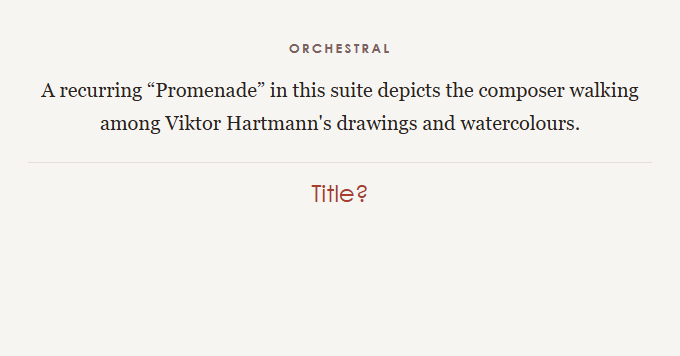
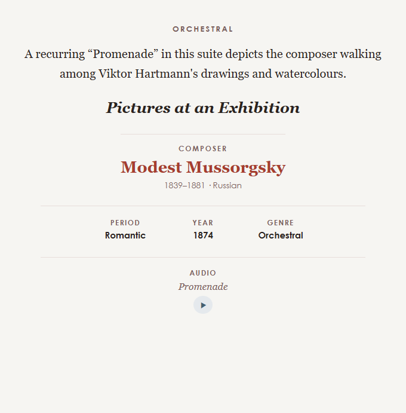
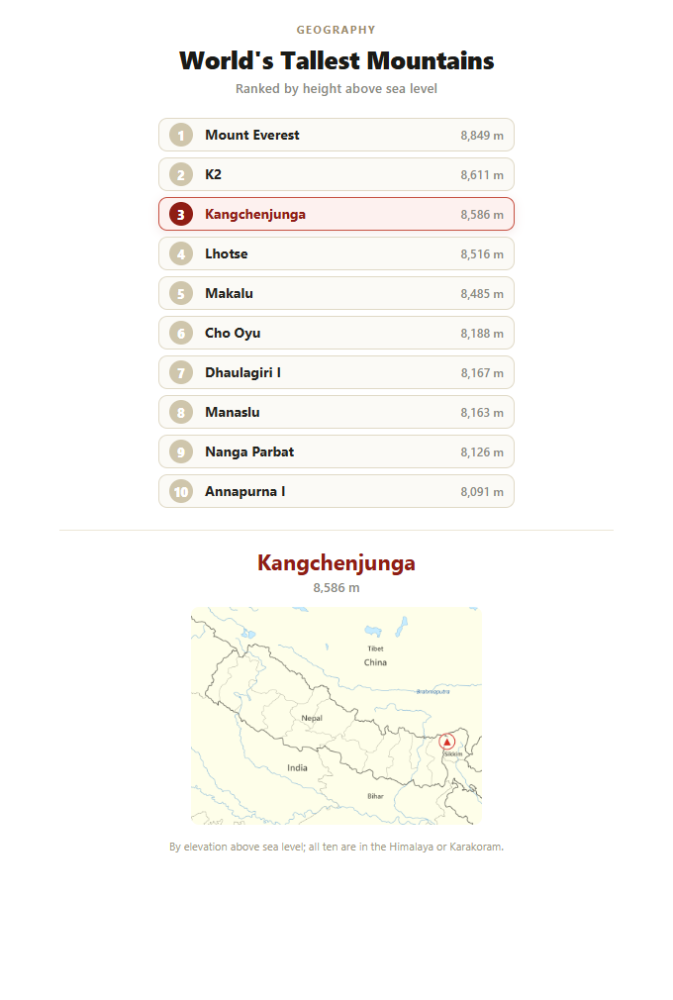
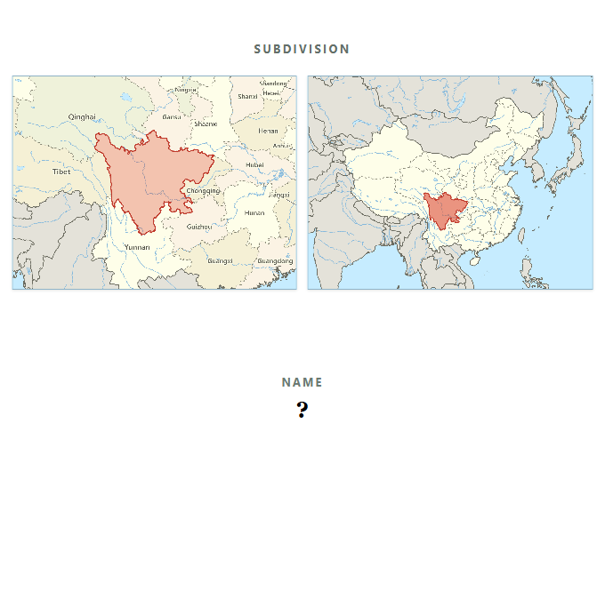
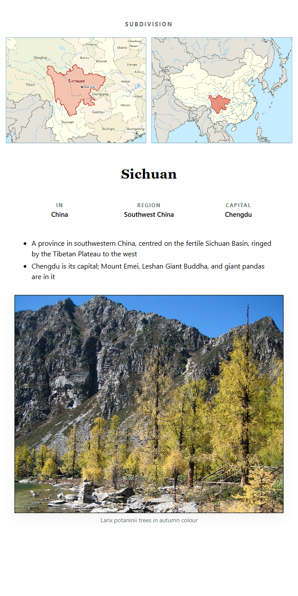

# Quizbowl study tools

Tools for researching clues, studying cards, and practicing tossups.

- [StockFisher](#stockfisher) finds recurring clues in QBReader questions.
- [Anki cards](#anki-cards) cover physics, biology, fine arts, history, and other subjects.
- [Buzz Drill](#buzz-drill) displays tossups word by word and records practice sessions.

## StockFisher

StockFisher finds recurring clues in QBReader questions and pairs them with source questions side-by-side. It runs locally as a native desktop app using Python's standard library.

1. [Set it up](#setup), then run `python -m qbr.app`. On Windows, double-click **Open StockFisher.cmd**.
2. Enter an answer, optionally choose filters, and select **Find clues**.
3. Select **Read question** to open the source beside your results. Tick useful clues and select **Export CSV** to save them with their sources.


**Question text** searches passages across answers, with pagination through all matching results. **Check a draft** checks wording for answer leakage and corpus support. Optional Anki comparisons distinguish active matches, suspended notes, and text mentions. These labels do not establish that a clue is tested on the front of an active card.

See the [user guide](docs/stockfisher.md) for filters, ranking, exports, and troubleshooting. The [Python API and command line](qbr/README.md) provide the same search and extraction engine for scripts and terminal workflows.

### How it works

StockFisher uses questions from [QBReader](https://www.qbreader.org/). The sync command downloads them through QBReader's API and builds a local SQLite index. Searches and clue rankings run against that index, which lets the program compare many questions without fetching them again for every search. A sync downloads new sets and checks recent sets for changes; older edits require a full sync. Results reflect the last sync, rather than the live site. In November 2026, the index held 671,413 answerable units from 716 sets.

Clues are suggestions, not fact checks. Read the source questions before using them, and check whether a clue uniquely identifies its answer.

### Setup

Python 3.9+ and SQLite with FTS5 are required. The first sync downloads the questions and builds the index, which is roughly 900 MB:

```bash
git clone https://github.com/tygerthelyon/qbcards.git
cd qbcards
python -m qbr sync
python -m qbr.app
```

The app uses Python's standard library; no packages need installing. For later sessions, run `python -m qbr.app` or use the Windows shortcut. Chrome or Edge opens a dedicated app window on Windows; other setups open the default browser. Update the index when needed with `python -m qbr sync`; the interface shows the last successful sync time.

If you already have an index elsewhere, select **Index** and enter its path, or set `QBR_DB` before starting. AnkiConnect is needed only for Anki comparisons; those comparisons do not change the collection. The [user guide](docs/stockfisher.md) covers startup, shutting down, and the optional notebook interface.

## Anki cards

The collection had 11,921 notes and 34,848 cards in November 2026. These examples show the front and back of cards from the collection. Audio controls in the images are static.

| Art: front | Art: back |
| --- | --- |
|  |  |
| Classical music: front | Classical music: back |
|  |  |
| Ranked list: front | Ranked list: back |
|  |  |
| Geography: front | Geography: back |
|  |  |

[See the full gallery](docs/card-gallery.md) for examples of all 11 populated note types, including biology and physics cards.

Download the [Anki decks](https://github.com/tygerthelyon/qbcards/releases/tag/decks-2026-11-12) to import them into Anki. See the [download guide](docs/decks.md) for the subject list and import instructions. The repository also includes [sample notes](samples/), [note-type definitions](templates/models.json), and [collection utilities](scripts/).

These cards are personal study materials and may contain mistakes. Check important facts against reliable sources.

## Buzz Drill

The practice pool contains 1,864 tossups selected for the study collection. Choose categories and a reading speed, buzz with Space, then reveal the answer and score yourself. Session history stays in browser storage.


From the repository root, run:

```bash
python -m http.server 8000
```

Open <http://localhost:8000/drill/buzz-drill.html>. Buzz Drill does not require the StockFisher index or Anki.

## Tests and sources

Run the offline tests with `python -m unittest discover -s tests -v`. The larger `python -m qbr.selftest` also checks a synced index against the live QBReader API and requires a network connection.

StockFisher and Buzz Drill use questions made available through QBReader. The questions remain the work of their writers and tournament hosts; see [QBReader's notes on question sources and non-commercial use](https://github.com/qbreader#questions).

The software in this repository is available under the [MIT License](LICENSE). The license does not cover third-party questions, artwork, photographs, maps, audio recordings, or other third-party material in the examples and decks; those remain subject to their respective rights and licenses.
