# Anki card gallery

Examples from the collection, shown as front and back pairs. These are static previews; the audio button does not play. The biology example shows the back with its notes expanded.

## Art: image to title

| Front | Back |
| --- | --- |
| 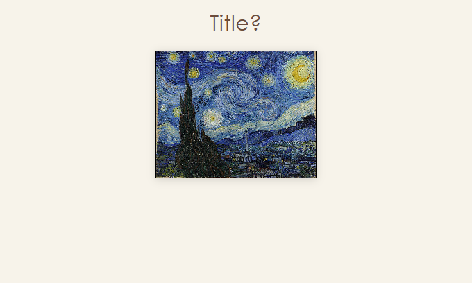 | 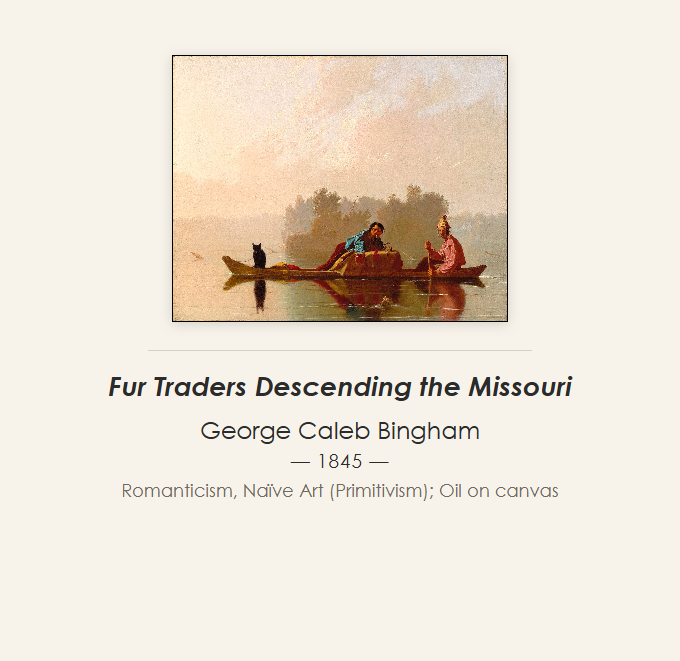 |

## Architecture: image to name

| Front | Back |
| --- | --- |
| 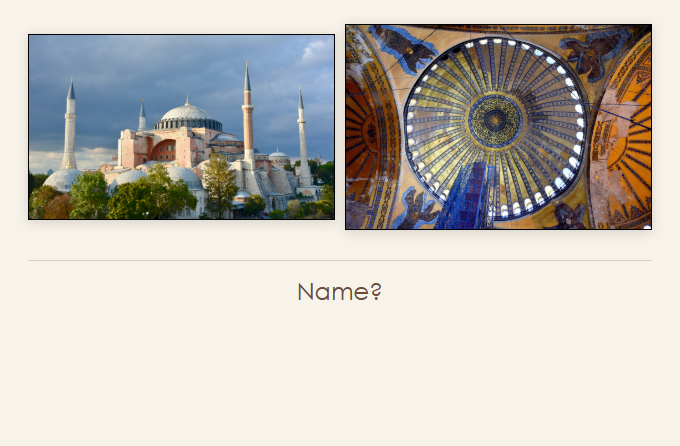 | 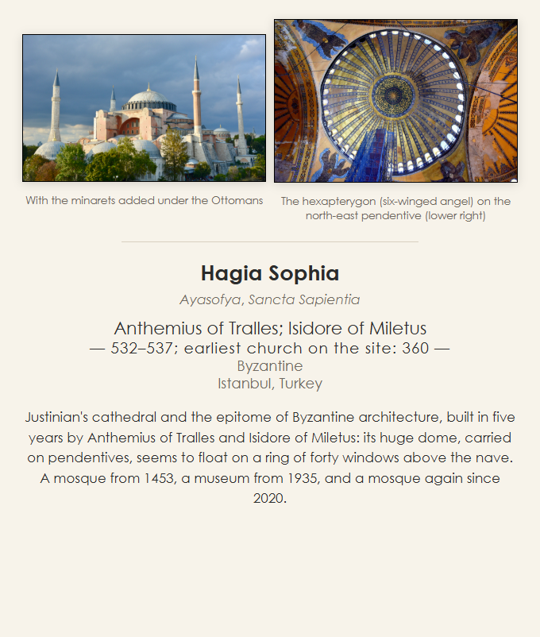 |

## Classical music: clue to work

| Front | Back |
| --- | --- |
| 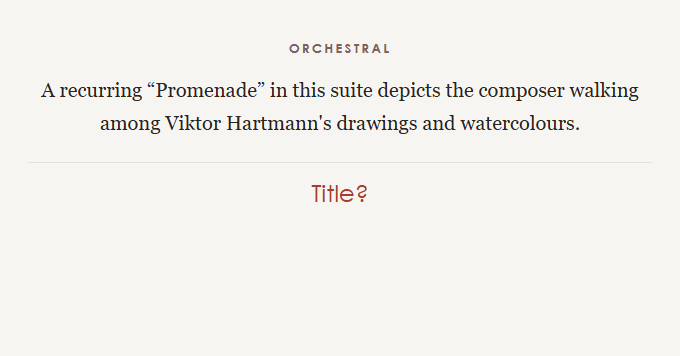 | 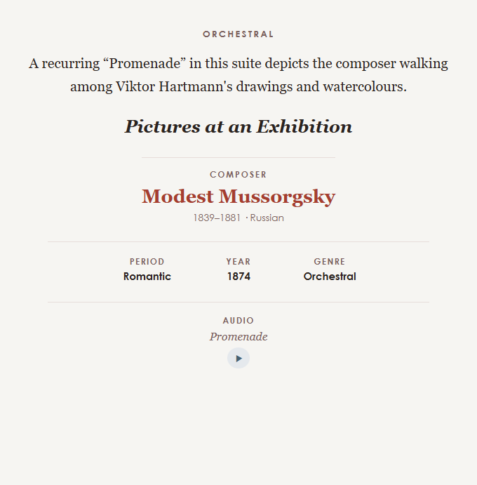 |

## Performing arts: image to work

| Front | Back |
| --- | --- |
| 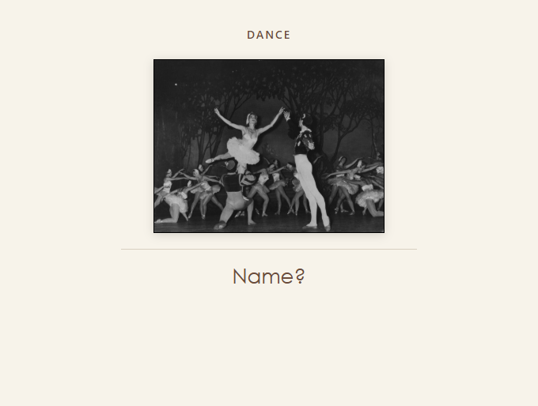 | 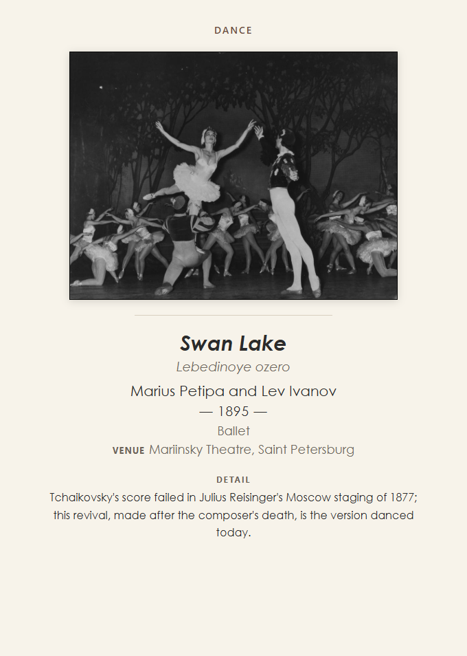 |

## Film: still to title

| Front | Back |
| --- | --- |
| 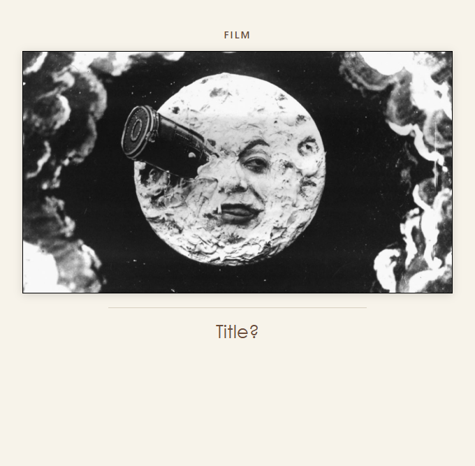 | 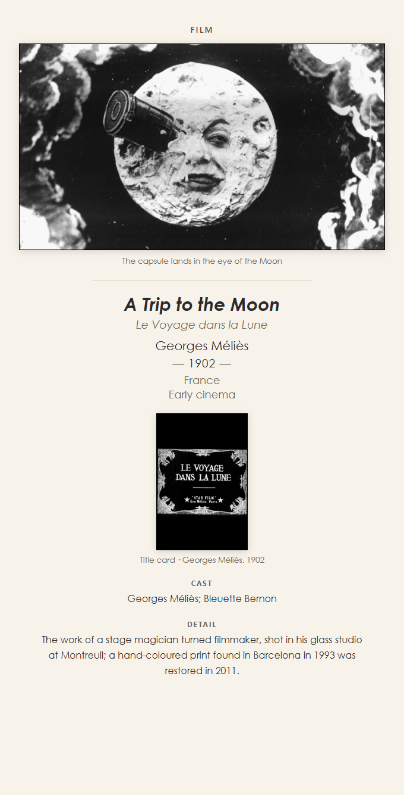 |

## Photography: image to title

| Front | Back |
| --- | --- |
| 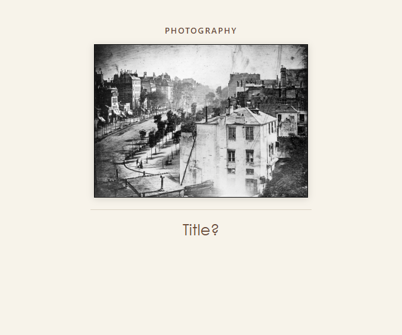 | 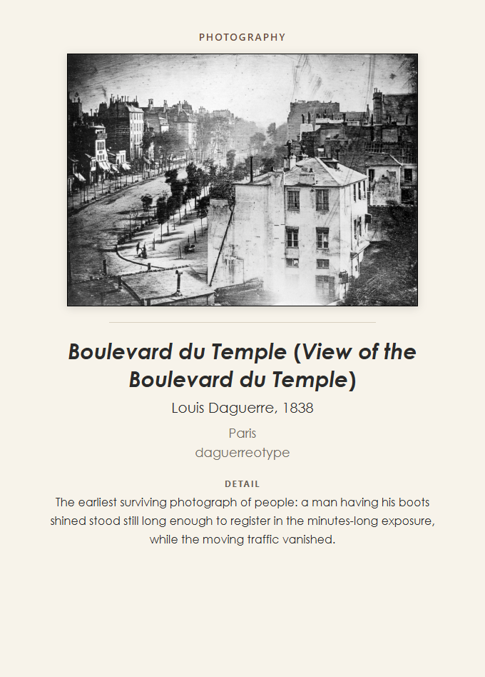 |

## Geography: province

| Front | Back |
| --- | --- |
| 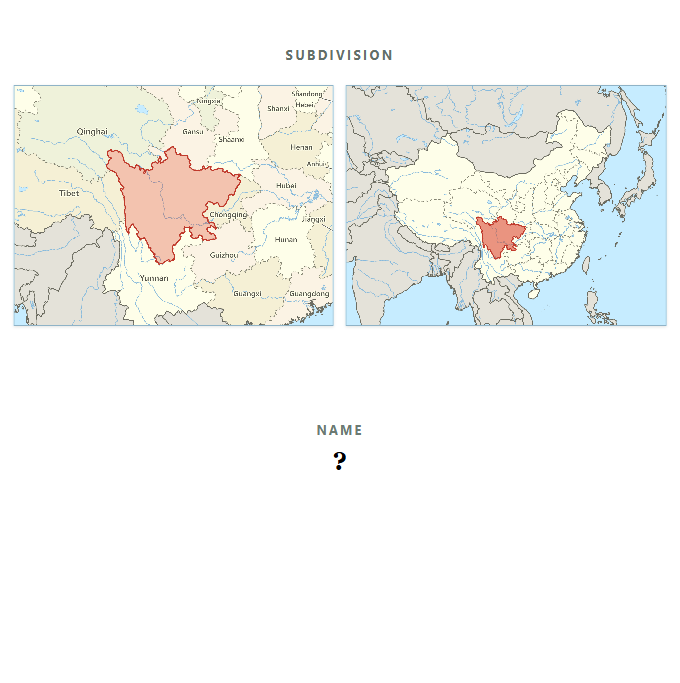 | 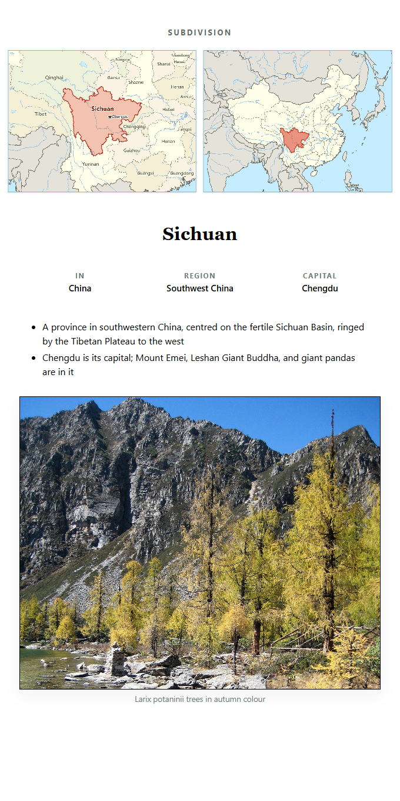 |

## Geology: definition to name

| Front | Back |
| --- | --- |
| 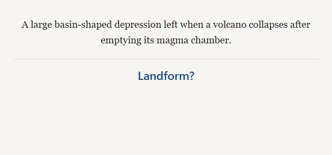 | 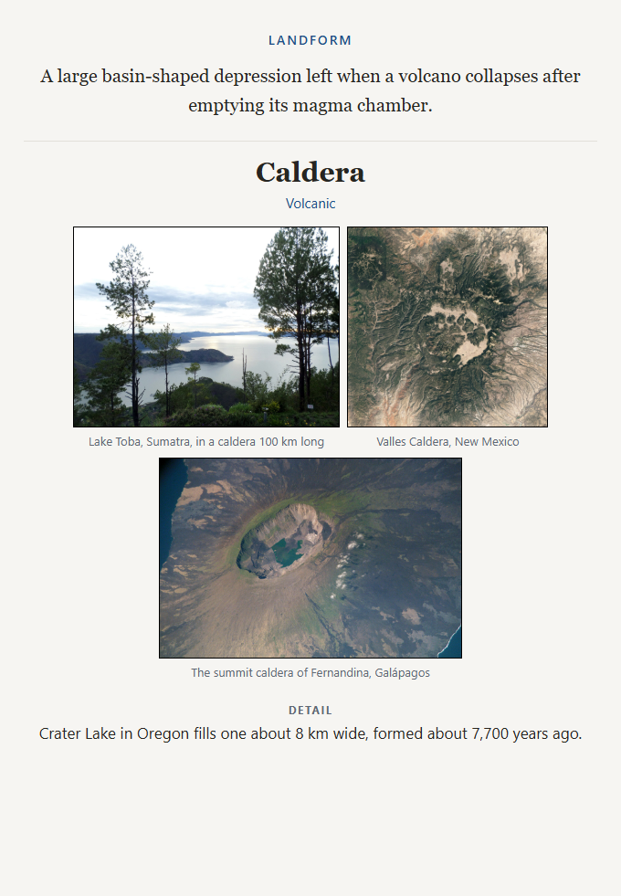 |

## List: ranked item

| Front | Back |
| --- | --- |
| 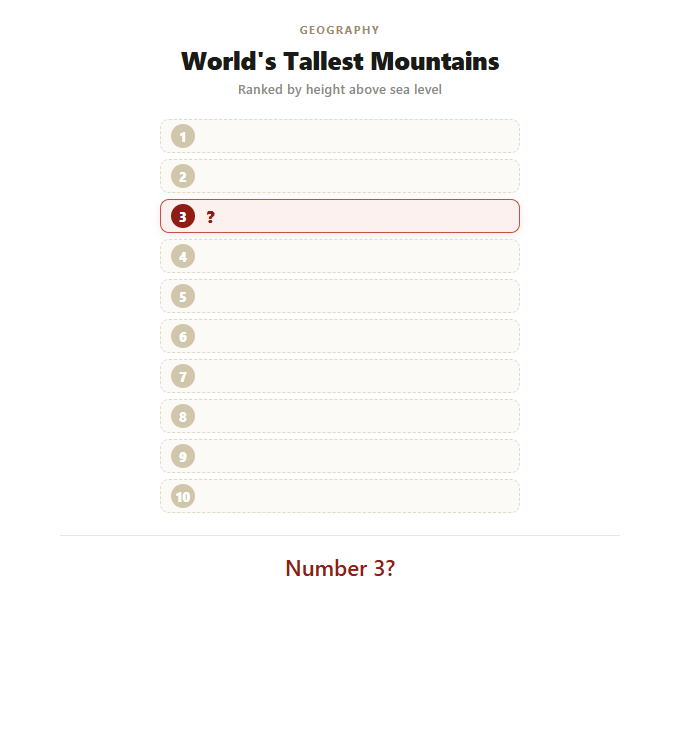 | 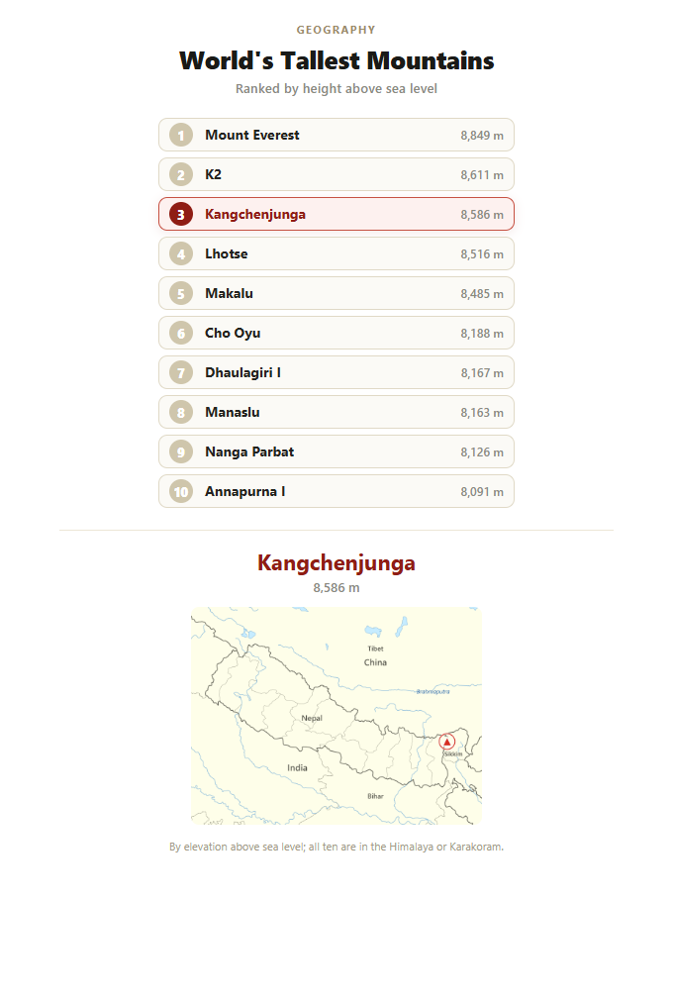 |

## Poetry: work to poet

| Front | Back |
| --- | --- |
| 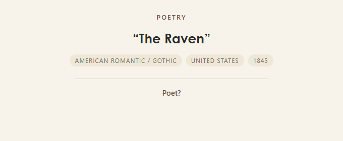 | 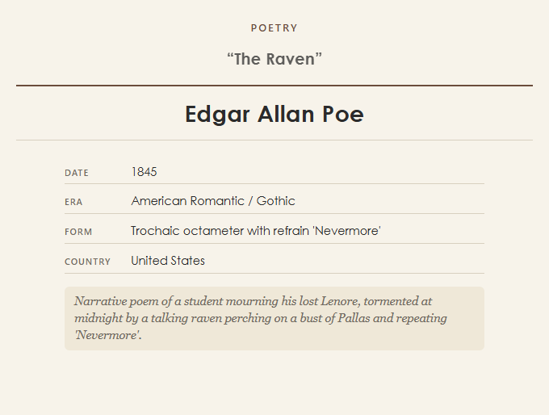 |

## Biology: cloze

| Front | Back |
| --- | --- |
| 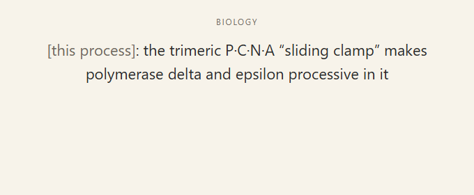 | 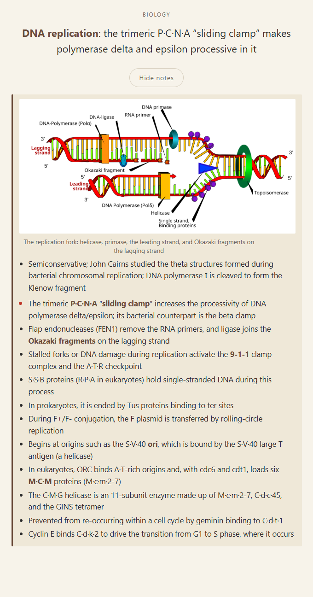 |

## Physics: cloze

| Front | Back |
| --- | --- |
| 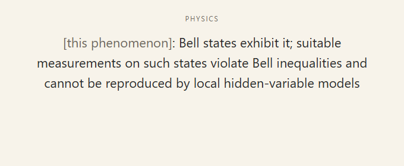 | 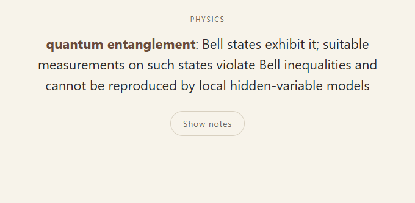 |

[Back to the project](../README.md)
